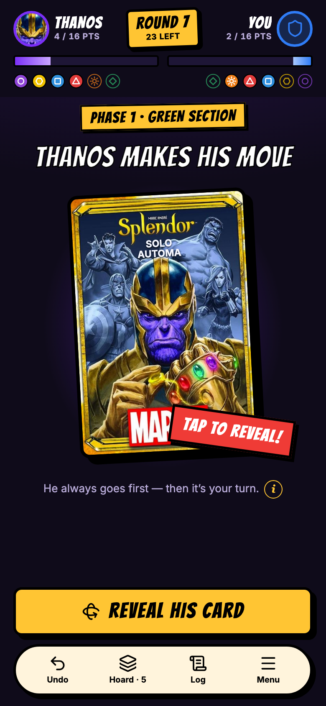
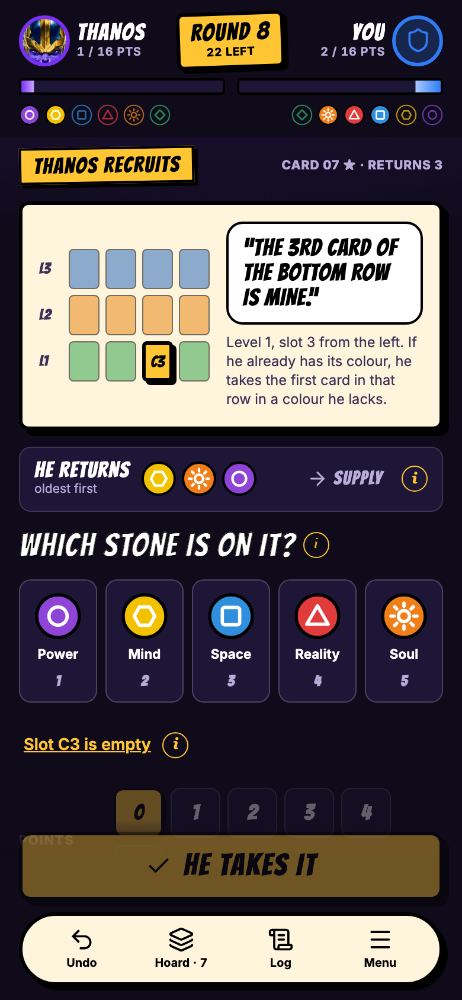
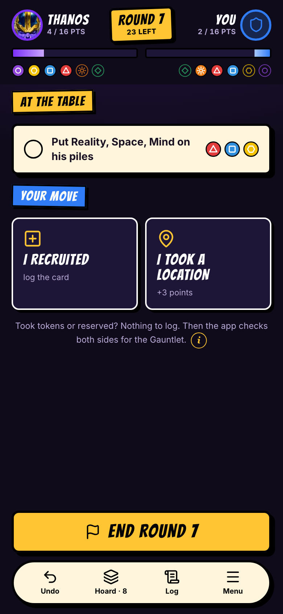
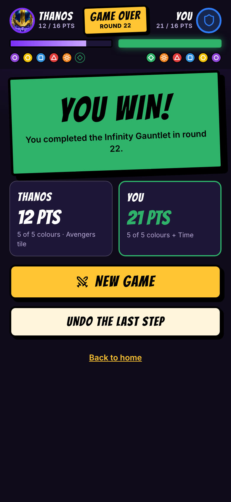

<p align="center">
  
</p>

<h1 align="center">Splendor Marvel: Solo Automa companion</h1>

A phone-first web app (PWA) for playing **Splendor Marvel** solo against the fan-made **Thanos
automa**.

It is a *companion* to the physical game, not a digital version. The market, the tokens and your cards
stay on the table. The app replaces the automa deck, the token placement board and all of Thanos's
bookkeeping.

**[Project page](https://thanos.silachev.com/)**: a short tour with
screenshots, in English, [Русский](https://thanos.silachev.com/ru/),
[Српски](https://thanos.silachev.com/sr/),
[Español](https://thanos.silachev.com/es/) and
[Deutsch](https://thanos.silachev.com/de/).

> **Status:** in development. Work is planned in
> [issues](https://github.com/asilachev/splendor-marvel-automa/issues) and
> [milestones](https://github.com/asilachev/splendor-marvel-automa/milestones).

## What it does

- **Runs the automa deck.** It shuffles and flips the deck, changes phase after rounds 10 and 20, and
  enforces the 30-round limit.
- **Tells you what Thanos does:**
  - which tokens to take;
  - which card he recruits, including the colour-substitution rule;
  - which tokens to return, oldest first.
- **Keeps Thanos's state:** his ordered token stack, colours, Time stone, points, Avengers tags, and the
  Avengers Assemble tile.
- **Checks for a winner.** At the end of every round it checks the Infinity Gauntlet condition and
  applies the official tiebreakers.
- **Handles real table use:**
  - undo for every step;
  - survives reloads;
  - works offline;
  - keeps the screen awake.
- **Explains the rules in place.** Tap the "i" next to a rule to read it at the table.
- **Keeps your history:** every finished game, with your win rate and average winning round, overall
  and per difficulty.
- **Lets you skip logging your cards:** tick "I completed the Gauntlet" in the round you do instead.
- **Plays the PDF's hard variant:** Thanos also claims the Locations, and you don't.
- **Speaks five languages:** English, Русский, Српски, Español and Deutsch. It follows your phone's
  language, and the globe button on Home switches it.
- **Needs no card data.** When a card is recruited you tap its colour, points and Avengers tags. There
  is no card database and no game art.

## How to play

Set up a normal 2-player game, then let the app run Thanos. Each round you flip his card, do what it
says on the table, play your own turn and tap **END ROUND**. The app keeps his tokens, cards and
points, and checks the Infinity Gauntlet for both sides. The
**[step-by-step guide](docs/guide/README.md)** walks through every screen.

<p>
  <a href="docs/guide/README.md#3-thanoss-turn"></a>
  <a href="docs/guide/README.md#3-thanoss-turn"></a>
  <a href="docs/guide/README.md#4-your-turn"></a>
  <a href="docs/guide/README.md#7-how-the-game-ends"></a>
</p>

## Rules

- **Official game rules.** [`docs/rules.md`](docs/rules.md) summarises everything the app relies on,
  with page references. The official rulebook and the automa PDF are attached to the private
  [`reference-docs` release](https://github.com/asilachev/splendor-marvel-automa/releases/tag/reference-docs);
  `npm run reference` downloads them into `docs/reference/`. The game's page is on
  [BGG](https://boardgamegeek.com/boardgame/293296/splendor-marvel).
- **Automa rules.** [`docs/automa.md`](docs/automa.md) has:
  - the full card list, checked against the PDF;
  - clarifications from BGG;
  - the rulings the app uses for gaps in the PDF;
  - a simulation of how the settings change Thanos's tokens and timing.
- **App design.** [`docs/design.md`](docs/design.md).

## Credits

- **Splendor Marvel** is designed by Marc André and published by
  [Space Cowboys](https://www.spacecowboys-games.com/game/splendor-marvel/) (2020). © Space Cowboys,
  © MARVEL.
  - **Where to buy:** find a shop with
    [Asmodee's store locator](https://storelocator.asmodee.com/), or see the offers on its
    [BoardGameGeek page](https://boardgamegeek.com/boardgame/293296/splendor-marvel). You need the
    physical game to use the app.
- **The solo automa** was designed by **Dukefanblue2005** on BGG, originally for Splendor
  ([Splendor Automa](https://boardgamegeek.com/filepage/201926)). The app runs its Marvel re-theme,
  whose author prefers not to be credited.

**Fonts:**
- **Bangers Cyrillic** is the display font for every language: Bangers © 2011 Vernon Adams, under the
  SIL Open Font License 1.1, with a Cyrillic extension (2016) from
  [online-fonts.com](https://online-fonts.com/fonts/bangers-cyrillic). Original Bangers:
  [googlefonts/bangers](https://github.com/googlefonts/bangers). Provenance is in
  [`src/ui/assets/fonts/README.md`](src/ui/assets/fonts/README.md).
- **Inter** is the body font: © 2016 The Inter Project Authors, under the SIL Open Font License 1.1
  ([rsms/inter](https://github.com/rsms/inter)).

The Splendor and MARVEL logos and the automa card-back art in `src/ui/assets/official/` belong to
their owners. They are used here for personal, non-commercial use only.

This is an unofficial personal fan project. It is not affiliated with or endorsed by Space Cowboys,
Asmodee or Marvel, and you need the physical game to use it.

The author of the Marvel re-theme dislikes web apps for it and asked for links to them to be removed
from its BGG file page. **Please don't post this app there.** See the
[community note](docs/automa.md#community-note).

## License

The code is under the [MIT License](LICENSE). It covers our code only, not:
- the game Splendor Marvel, its rules and artwork (© Space Cowboys / Asmodee, ™ & © MARVEL),
  including the official art in `src/ui/assets/official/`;
- the automa's design, by Dukefanblue2005, or its Marvel re-theme;
- the fonts, which keep their own licenses (SIL Open Font License 1.1; see
  [`src/ui/assets/fonts/README.md`](src/ui/assets/fonts/README.md)).

## Deploy

The app is a static site. Host it on Vercel or on your own server with Docker: both serve the same
build with the same caching and security headers. Either way it needs HTTPS, which installing to the
home screen, offline mode and keeping the screen awake all require. Both also tell search engines not
to index the app (`X-Robots-Tag: noindex`); the [project page](https://thanos.silachev.com/)
is its public face.

### Vercel

[`vercel.ts`](vercel.ts) holds the whole setup: Vite, `npm run build`, `dist/`, caching and headers.
The free Hobby plan covers a non-commercial project like this one.

1. **Import the repo.** In Vercel, choose *Add New → Project*, import
   `asilachev/splendor-marvel-automa` and deploy. No settings to change.
2. **Add your domain** (optional). In the project's *Settings → Domains*, add one such as
   `app.thanos.silachev.com`, then create the DNS record Vercel shows (a CNAME for a subdomain).
   HTTPS is automatic.
3. **Updates are automatic.** Every push to `master` deploys to production, and every pull request
   gets a preview URL.
4. **Analytics** (optional). Turn on *Web Analytics* in the Vercel project. Builds made on Vercel
   then count page views: anonymous, no cookies. Builds made anywhere else contain no analytics.

### Docker (self-hosted)

Unprivileged nginx in an image of about 60 MB. Every push to `master` publishes
`ghcr.io/asilachev/splendor-marvel-automa:latest` for amd64 and arm64.

1. **Log in to GHCR once on your server.** The package is private. Create a GitHub token with
   `read:packages`, then run
   `echo $TOKEN | docker login ghcr.io -u asilachev --password-stdin`.
2. **Start it.** Copy [`docker-compose.yml`](docker-compose.yml) to the server and run
   `docker compose up -d`. It serves on port 8080.
3. **Add HTTPS.** Put it behind your reverse proxy (Caddy, Traefik, nginx…) with HTTPS.
4. **Update** with `docker compose pull && docker compose up -d`. The next time the app opens, phones
   show "A new version is ready · RELOAD". The game is saved after every tap, so reloading is safe.

To build from source instead, run `docker build -t thanos-automa . && docker run -p 8080:8080 thanos-automa`.

**On your phone:** open the URL. On Android/Chrome, tap **INSTALL** on the card on Home. On an
iPhone, follow the sheet: Share → *Add to Home Screen*.

## Development

[](https://github.com/asilachev/splendor-marvel-automa/actions/workflows/ci.yml)

```sh
npm ci
npm run dev        # http://localhost:5173 (use `npm run dev -- --host` to open it on your phone)
npm test           # Vitest
npm run e2e        # end-to-end smoke test on a phone viewport (Playwright, in your Google Chrome)
npm run build      # production build in dist/
npm run site:shots # the app in four more languages, for the landing page
npm run site       # landing page in _site/, five languages (deployed to GitHub Pages from master)
npm run sim        # Thanos alone, 10,000 games per settings preset (docs/automa.md → Simulation)
```

Built with Vite, React and TypeScript, with a pure TypeScript automa engine in `src/engine`.
Contributor and agent guidance, including commands, layout, workflow and conventions, is in
[AGENTS.md](AGENTS.md).
