# How to play with the app

You play **Splendor Marvel** on the table as usual, against **Thanos**: the fan-made solo automa. The
app is his deck and his brain. It flips his card, tells you what he takes and what he gives back,
keeps his tokens and cards in order, and checks the Infinity Gauntlet at the end of every round.

You need the physical game and a phone. The app has no card data. When someone recruits a card, you
tap its colour, points and Avengers tags.

The app speaks English, Русский, Српски, Español and Deutsch. It starts in your phone's language;
change it with the globe button at the top of the home screen, or under **Menu → Language**.

**Contents**

1. [Install the app](#1-install-the-app)
2. [Start a game](#2-start-a-game)
3. [Thanos's turn](#3-thanoss-turn)
4. [Your turn](#4-your-turn)
5. [New phase, reshuffled deck](#5-new-phase-reshuffled-deck)
6. [The dock: undo, hoard, log, menu](#6-the-dock-undo-hoard-log-menu)
7. [How the game ends](#7-how-the-game-ends)
8. [Ending a game early](#8-ending-a-game-early)

## 1. Install the app

Installing is optional, but recommended: the app then runs full screen, works offline and keeps the
screen awake during a game.

- **iPhone or iPad (Safari):** on first launch a sheet shows how to install it: tap **Share**, then
  **Add to Home Screen**.
- **Android (Chrome):** tap **INSTALL** on the card on the home screen.

<table>
  <tr>
    <td align="center" valign="top">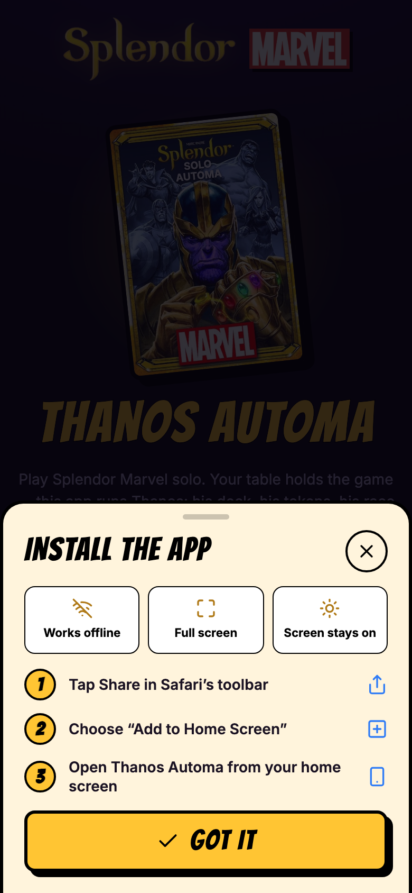 iPhone: the install sheet</td>
    <td align="center" valign="top">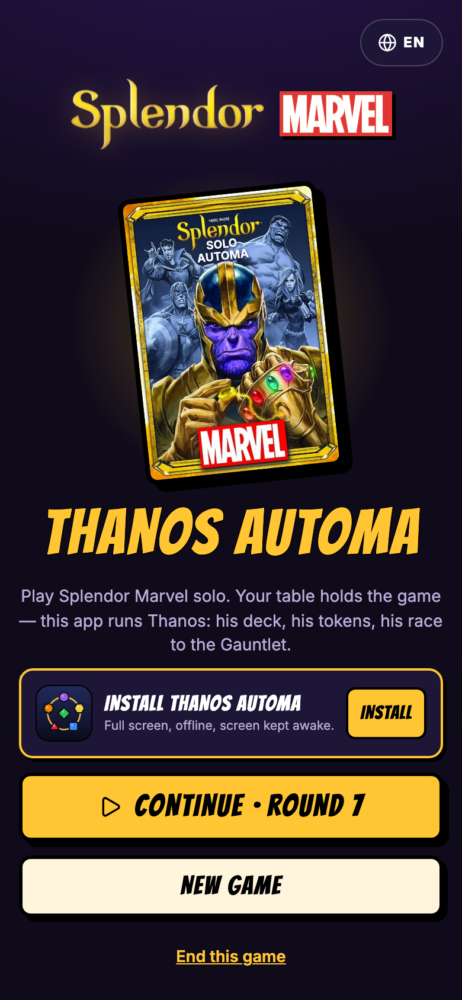 Android: the Install card</td>
  </tr>
</table>

## 2. Start a game

1. On the home screen, tap **START YOUR FIRST GAME**. Later, the home screen shows **CONTINUE ·
   ROUND N** for the game in progress: it is saved after every tap.
2. **Set up the table** for a normal 2-player game, ticking the checklist as you go: 4 cards per level
   (level 1 at the bottom), 4 tokens of each colour, 2 green, all 5 grey, 2 random Locations, and the
   Avengers and Gauntlet tiles. Leave some space for Thanos's token piles.
3. **Choose the difficulty.** 30 rounds is the automa as printed; 27 and 24 rounds are community
   tweaks that make him harder. A cap of 12 tokens on his piles is another community tweak.
   **Variant:** **HARD** is the automa PDF's hard variant, where Thanos also claims Locations and you
   don't. Enter what the two Location tiles on the table ask for, tapping a stone once per bonus.
   **Your cards:** keep **LOG THEM** so the app scores your side, or pick **DON'T LOG** to just play.
   Then you tick **I COMPLETED THE GAUNTLET** in the round you do, and move the Avengers tile
   yourself.
4. **Rulings** (optional). The automa PDF leaves four gaps. The defaults follow the clarifications on
   BoardGameGeek; tap **i** next to each one to read why.
5. Tap **START GAME**.

<table>
  <tr>
    <td align="center" valign="top">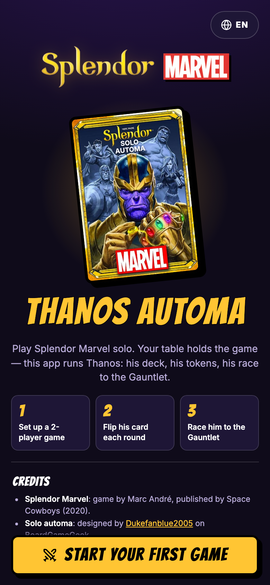 Home</td>
    <td align="center" valign="top">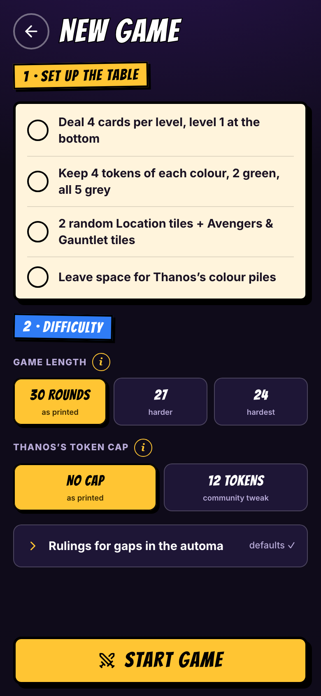 Set up the table, choose the difficulty</td>
    <td align="center" valign="top">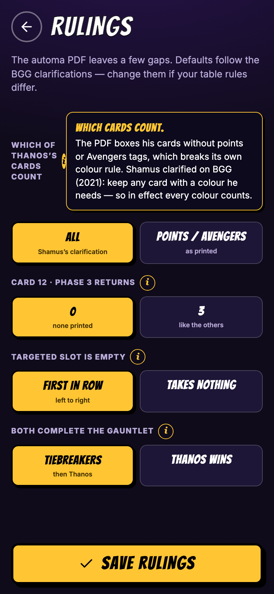 Rulings, with a tip open</td>
  </tr>
</table>

## 3. Thanos's turn

Thanos always goes first. The bar at the top shows both sides: points out of 16, the colours each side
has, and the round clock.

1. **Flip his card.** Tap the card, or **REVEAL HIS CARD**. The caption says which section of the card
   he uses: green in rounds 1–10, yellow in 11–20, red in 21–30.
2. **If he takes tokens,** move them from the supply onto his piles, in the order shown. If a colour's
   pile in the supply is empty, tap that token so he skips it. Tap **DONE**.
3. **If he recruits,** the map shows the slot: row A is level 3 at the top, C is level 1 at the
   bottom, and columns count from the left.
   - **HE RETURNS:** put these tokens back in the supply. His oldest tokens go first, and the app
     keeps track of the order.
   - Tap the colour of the card in that slot, then its points and Avengers tags, and **HE TAKES IT**.
     Move the card next to his piles and refill the market.
4. **Colour substitution:** if he already has that colour, he takes the first card in the same row,
   from the left, in a colour he lacks. The app asks for that colour. If the row has no such card, he
   takes the original one. If the slot is empty, tap the **empty** link below the colours.

<table>
  <tr>
    <td align="center" valign="top"> Flip his card</td>
    <td align="center" valign="top">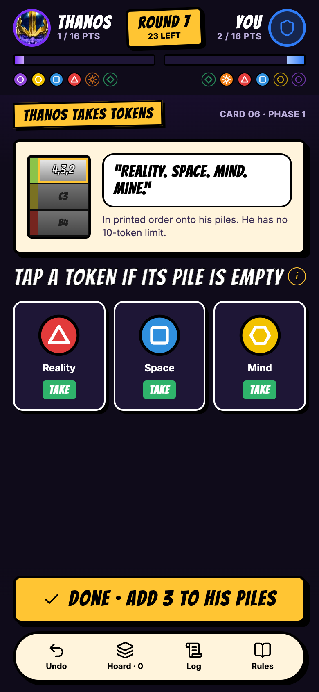 He takes tokens</td>
  </tr>
  <tr>
    <td align="center" valign="top"> He recruits and returns tokens</td>
    <td align="center" valign="top">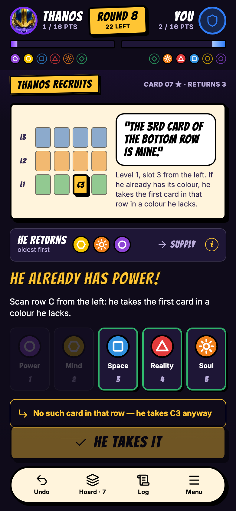 Colour substitution</td>
  </tr>
</table>

## 4. Your turn

1. **At the table:** the checklist sums up what changes on the table after his move. Tick each line
   as you do it.
2. **Your move:** play your turn on the table, exactly as in the normal game.
   - Recruited a card? Tap **I RECRUITED** and log its level, bonus colour, points and Avengers tags.
     The tile turns gold, **CARD LOGGED**: one card per turn. Logged the wrong one? Tap **Undo**.
     If you now have more Avengers tags than Thanos, the app tells you to take the Avengers tile.
   - Took a Location? Tap **I TOOK A LOCATION** (+3 points). It turns gold too: **LOCATION TAKEN**.
   - Took tokens or reserved a card? There is nothing to log.
   - Not logging your cards? The two tiles become **I COMPLETED THE GAUNTLET**, ticked only in the
     round you complete it, and the Avengers tile control. If Thanos completes it in the same round,
     enter your points and card count for the tiebreakers.
3. Tap **END ROUND N**. The app then checks both sides for the Infinity Gauntlet.

<table>
  <tr>
    <td align="center" valign="top"> At the table, your move</td>
    <td align="center" valign="top">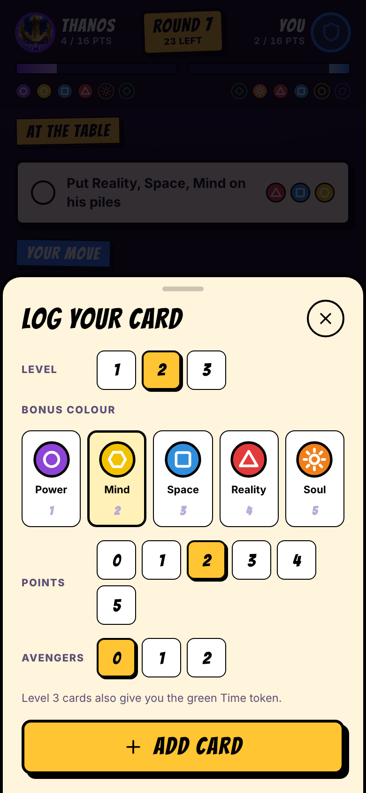 Log the card you recruited</td>
  </tr>
</table>

## 5. New phase, reshuffled deck

After rounds 10 and 20 the app reshuffles his deck, and from then on he reads the next section of
each card. Every card is used once per phase.

<table>
  <tr>
    <td align="center" valign="top">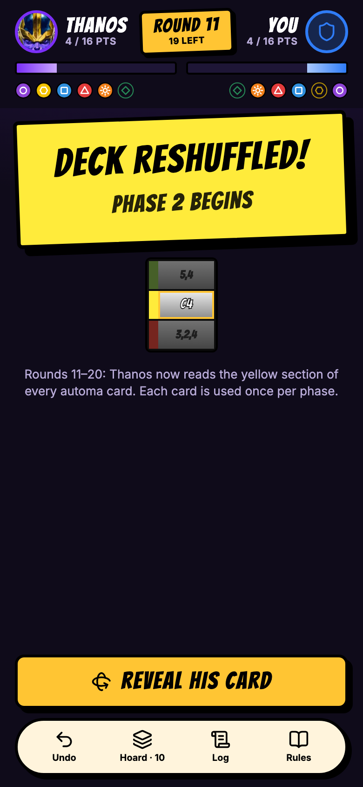 Phase 2 begins</td>
  </tr>
</table>

## 6. The dock: undo, hoard, log, menu

The bar at the bottom is always there during a game.

- **Undo** steps back one action. Use it for any mistake; you can undo all the way back.
- **Hoard** shows his tokens as colour piles, which ones go back first, and his cards. If the table
  and the app ever disagree, tap **FIX** to correct his piles, his cards or the Avengers tile.
- **Log** lists everything that happened, newest round first.
- **Menu** starts with **BACK TO HOME** (the game stays saved) and **END THIS GAME**. Below them:
  the rules at a glance, the keep-the-screen-awake switch, this game's rulings and the credits.

<table>
  <tr>
    <td align="center" valign="top">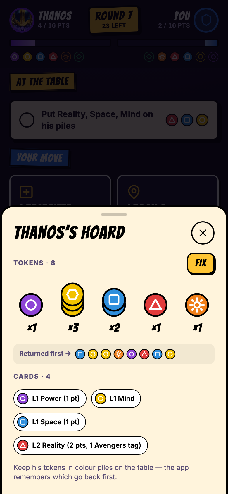 Hoard</td>
    <td align="center" valign="top">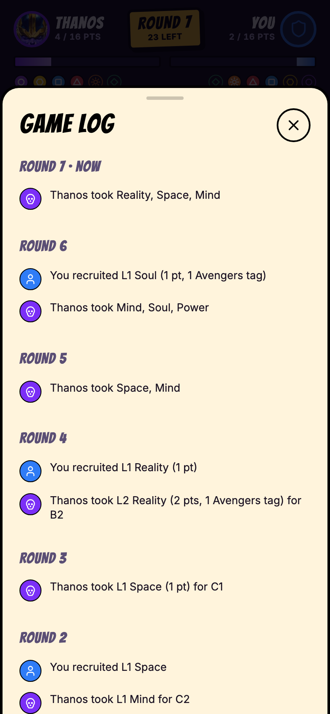 Log</td>
    <td align="center" valign="top">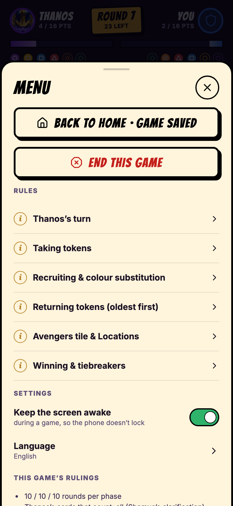 Menu</td>
  </tr>
</table>

## 7. How the game ends

The Infinity Gauntlet needs **16 or more points**, **a bonus of each of the 5 colours** and **the
green Time token**, which comes with your first level-3 card. The app checks it at the end of every
round.

- **You win** if you complete the Gauntlet first.
- **Thanos wins** if he completes it first, or with **SNAP** if round 30 ends without your Gauntlet.
  Points alone are not enough: without the Time token there is no Gauntlet.
- If both complete it in the same round, the default ruling applies the official tiebreakers (most
  points, then the Avengers tile, then fewer cards). Any remaining tie goes to Thanos.

Tap **NEW GAME** to play again, or **UNDO THE LAST STEP** if the ending came from a mistake.

Every finished game goes into **Game history** on the home screen: your games, wins, win rate and
average winning round, overall and per difficulty, with each game listed. Undoing a game's ending takes
it out again, and **CLEAR HISTORY** empties it.

<table>
  <tr>
    <td align="center" valign="top"> You win</td>
    <td align="center" valign="top">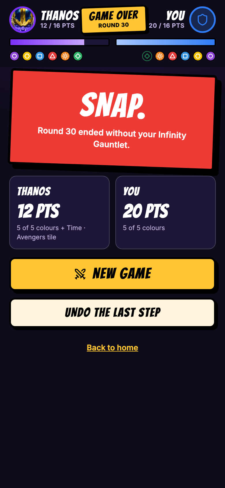 SNAP: Thanos wins</td>
  </tr>
</table>

## 8. Ending a game early

To stop the game in progress, open **Menu** and tap **END THIS GAME**, or tap **End this game** on
the home screen. The app asks first, because ending a game clears it: Undo can't bring it back.
Tap **END GAME** to confirm, or **KEEP PLAYING**.

To pause instead, tap **BACK TO HOME** in the menu, or simply close the app. The game is saved after
every tap, and **CONTINUE** picks it up again.

<table>
  <tr>
    <td align="center" valign="top">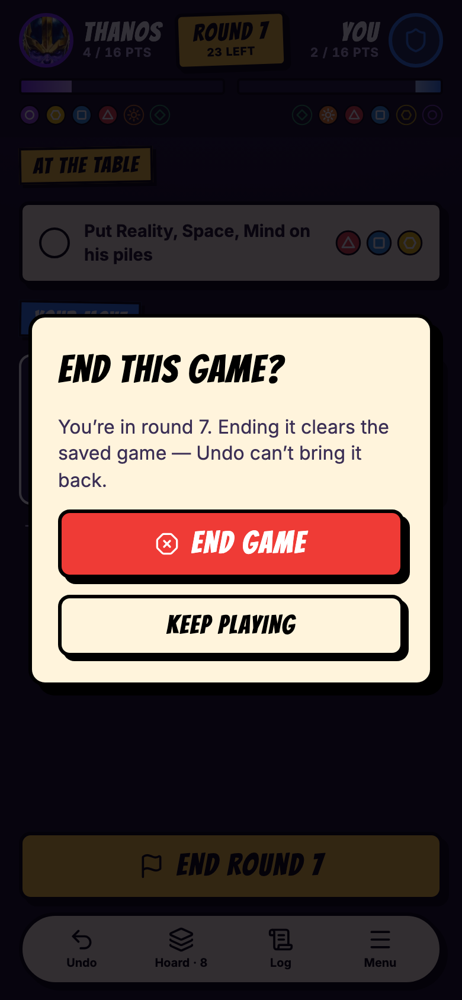 End this game?</td>
  </tr>
</table>

## About the screenshots

Every screenshot is exactly **780 × 1688 pixels**: a 390 × 844 phone screen at 2×.
`npm run screenshots` builds the app and captures them all again from fixed game states in Chrome.
It fails if any image has a different size.

## Credits

Splendor Marvel is by Marc André, published by Space Cowboys. The solo automa is by Dukefanblue2005
on BoardGameGeek. This is an unofficial fan tool; see the [main README](../../README.md#credits).
